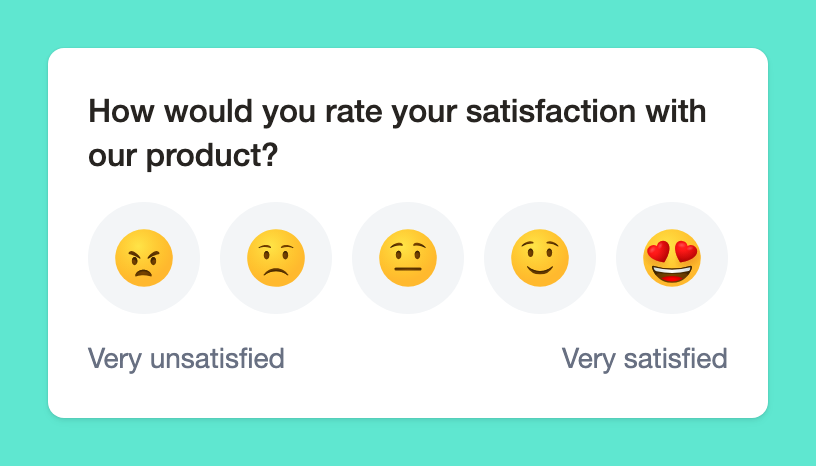
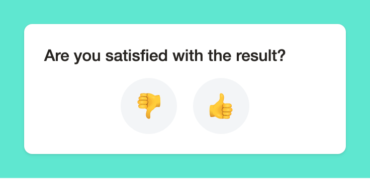
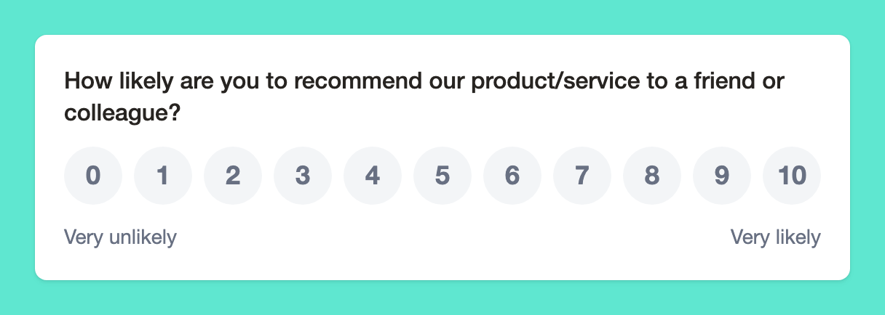
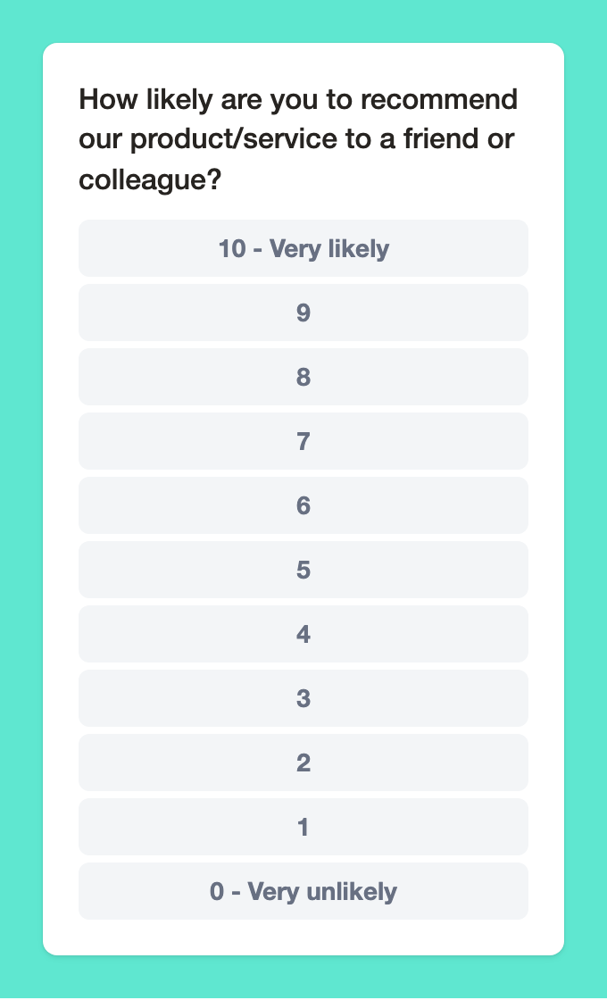
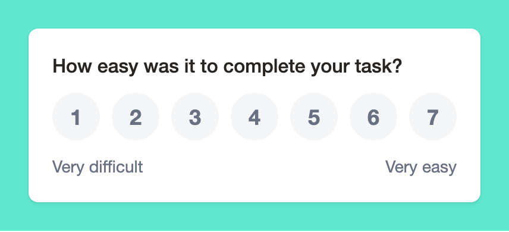
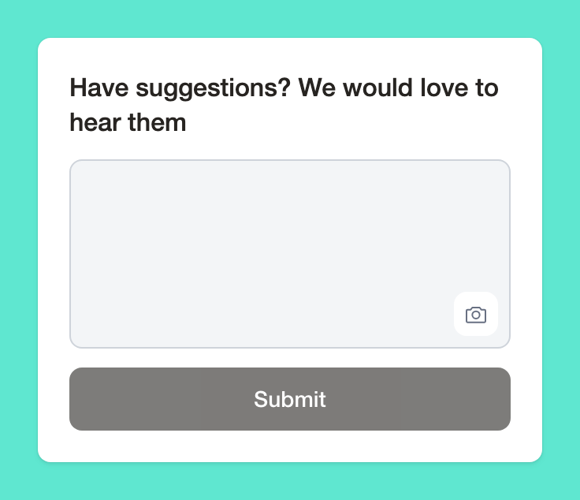
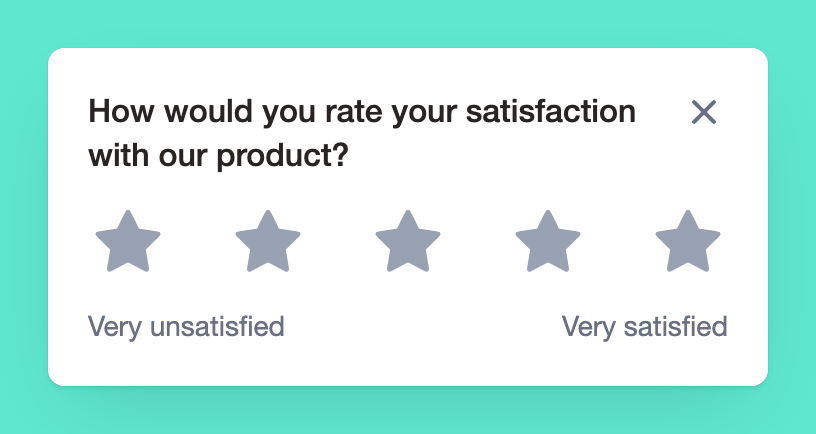
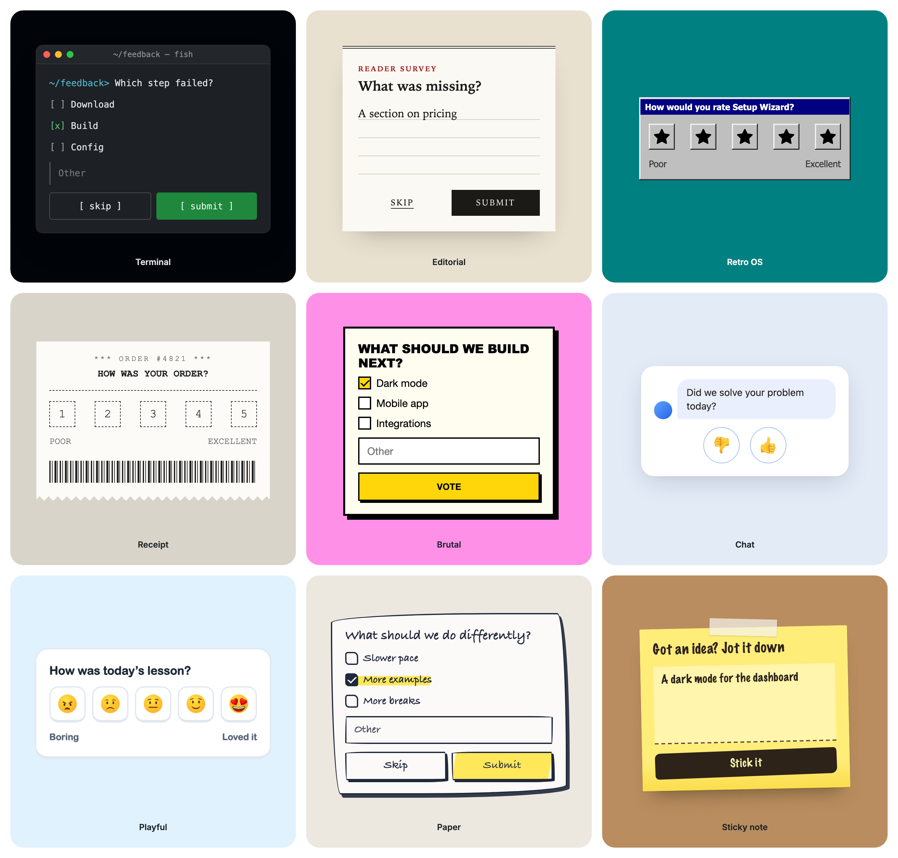

# react-feedback-surveys

[](https://www.npmjs.com/package/react-feedback-surveys)
[](https://www.npmjs.com/package/react-feedback-surveys)
[](https://github.com/feedback-tools-platform/react-feedback-surveys/blob/main/LICENSE)
[](https://bundlephobia.com/package/react-feedback-surveys)
[](https://github.com/feedback-tools-platform/react-feedback-surveys/actions/workflows/ci.yml)
[](https://feedback.tools/react-feedback-surveys/storybook/)

> Lightweight, customizable survey widgets to collect user feedback in React apps.

## Introduction

react-feedback-surveys is a standalone, open-source (MIT) UI library — no backend, no hosting, no
account required. Render the components, wire `onScoreSubmit`/`onFeedbackSubmit` to your own backend
(or nowhere at all).

Want AI-generated insights, a hosted dashboard, and response storage without building your own backend?
Check out [feedback.tools](https://feedback.tools) — built by the same team.

## Table of Contents

- [Introduction](#introduction)
- [Features](#features)
- [Installation](#installation)
    * [1. Install](#1-install)
    * [2. Styles](#2-styles)
    * [Requirements](#requirements)
    * [Next.js and Server Rendering](#nextjs-and-server-rendering)
- [Quick Start](#quick-start)
- [Survey Types](#survey-types)
- [Survey Component](#survey-component)
    * [CSAT (Customer Satisfaction Score)](#csat-customer-satisfaction-score)
    * [NPS (Net Promoter Score)](#nps-net-promoter-score)
    * [CES (Customer Effort Score)](#ces-customer-effort-score)
    * [General (text feedback only)](#general-text-feedback-only)
- [Layout Components](#layout-components)
    * [Popup](#popup)
    * [Surface](#surface)
- [Props](#props)
    * [Shared Props](#shared-props)
    * [Accessibility Labels](#accessibility-labels)
    * [Shared Events](#shared-events)
    * [Attachments](#attachments)
- [Styling](#styling)
    * [Themes (Dark Mode)](#themes-dark-mode)
    * [Common Recipes](#common-recipes)
    * [Catalog Styles](#catalog-styles)
    * [Custom Styles](#custom-styles)
    * [How Styles Combine](#how-styles-combine)
    * [What's Stable](#whats-stable)
    * [CSS Variables](#css-variables)
    * [Custom Classes](#custom-classes)
    * [Shadow DOM Parts](#shadow-dom-parts)
- [Demo](#demo)
- [Contributing](#contributing)
    * [Local development (Storybook)](#local-development-storybook)
    * [Library build (watch mode)](#library-build-watch-mode)
    * [Production build](#production-build)
    * [Checks](#checks)
- [Roadmap](#roadmap)
- [Changelog](#changelog)
- [Credits](#credits)
- [License](#license)


## Features

- **A single `Survey` component** – the format (methodology, scale length, visual style) is configuration, not a different import
- **Ready-to-use survey formats** – CSAT (2 or 5 points), CES (7 points), NPS (0–10), and general text feedback
- **Multiple scale styles** – emoji, stars, numbers, thumbs
- **Flexible placement** – embed inline or display as popup overlay
- **Follow-up feedback** – optional text input or multiple choice responses
- **Optional email collection** – close the loop by capturing a respondent's email when no user identity is known
- **Optional screenshot attachments** – let respondents attach a screenshot, captured by a function you provide
- **Built-in themes** – light, dark, and auto (follows the system color scheme)
- **Deep visual customization** – colors, shapes, fonts, and every single part restyle from your CSS: variables, class names, and `::part()` always win over the defaults. See over a dozen ready-made looks in the [style catalog](https://feedback.tools/react-feedback-surveys/storybook/?path=/story/style-catalog--catalog)
- **Zero dependencies**
- **TypeScript support**

## Installation

### 1. Install

```shell
npm i react-feedback-surveys
# or
yarn add react-feedback-surveys
```

### 2. Styles

```tsx
import 'react-feedback-surveys/index.css';
```

### Requirements

- **React** 18 or 19.
- **Browsers:** Chrome and Edge 111+, Firefox 120+, Safari 16.4+ (iOS 16.4+).
- **ES modules only.** The package has no CommonJS build, so `require('react-feedback-surveys')` doesn't work.

### Next.js and Server Rendering

The components use React hooks, and the package has no `'use client'` directive. In the Next.js App Router, render a survey from a Client Component:

```tsx
'use client';

import { Survey } from 'react-feedback-surveys';
import 'react-feedback-surveys/index.css';

export function FeedbackSurvey() {
  return (
    <Survey
      type="nps"
      scaleStyle="numbers"
      question="How likely are you to recommend us?"
      thankYouMessage="Thanks for your feedback!"
      onScoreSubmit={({ value }) => {/* ... */}}
    />
  );
}
```

A Client Component is also required because the event handlers are functions, and a Server Component can't pass functions as props. Server rendering itself works: `theme="auto"` is pure CSS, so the page shows no flash of the wrong theme.

## Quick Start

```tsx
import { Survey } from 'react-feedback-surveys';
import 'react-feedback-surveys/index.css';

<Survey
  type="csat"
  points={5}
  scaleStyle="stars"
  question="How would you rate your satisfaction?"
  thankYouMessage="Thanks for your feedback!"
  onScoreSubmit={({ value }) => {/* send the rating to your backend */}}
/>
```

This renders an inline five-star survey. To show it in a corner of the screen, wrap it in [Popup](#popup). To ask a follow-up question after the rating, add `responseType` — see [Feedback Step](#feedback-step).

## Survey Types

One `Survey` component covers every format. `type` picks the methodology, `points` the scale length (CSAT only), and `scaleStyle` the look of the scale:

| Format                       | `type`      | `points` | `value` range | `scaleStyle`                          |
|------------------------------|-------------|----------|---------------|---------------------------------------|
| CSAT, 5-point                | `'csat'`    | `5`      | 1–5           | `'emoji'` \| `'numbers'` \| `'stars'` |
| CSAT, 2-point                | `'csat'`    | `2`      | 0–1           | `'emoji'` \| `'thumbs'`               |
| NPS                          | `'nps'`     | —        | 0–10          | `'numbers'`                           |
| CES                          | `'ces'`     | —        | 1–7           | `'numbers'`                           |
| General (text feedback only) | `'general'` | —        | no scale      | —                                     |

- `type` is required.
- `points` is required for `type="csat"` and not used for other types.
- `scaleStyle` is required for every type except `general`.
- `value` is the score that `onScoreSubmit` and `onFeedbackSubmit` receive.

TypeScript rejects invalid combinations, such as `type="ces"` with `scaleStyle="stars"`.

## Survey Component

Each format below has a screenshot and a full example.

### CSAT (Customer Satisfaction Score)

Surveys to ask users about their overall satisfaction, or about a specific feature or flow.

**Example questions:**
- "How satisfied are you with our product?"
- "Was this search helpful?"
- "Are you satisfied with the checkout process?"



```tsx
import { Survey } from 'react-feedback-surveys';
import 'react-feedback-surveys/index.css';

<Survey
  type="csat"
  points={5}
  scaleStyle="emoji"
  question="How would you rate your satisfaction with our product?"
  minLabel="Very unsatisfied"
  maxLabel="Very satisfied"
  responseType="text"
  textQuestion="We'd love to hear your thoughts — what can we improve?"
  textButtonSendLabel="Send"
  textButtonSkipLabel="Skip"
  thankYouMessage="Thanks for your feedback!"
  onScoreSubmit={({ value }) => {/* ... */}}
  onFeedbackSubmit={({ value, text }) => {/* ... */}}
/>
```



```tsx
<Survey
  type="csat"
  points={2}
  scaleStyle="thumbs"
  question="Are you satisfied with the result?"
  responseType="text"
  textQuestion="We'd love to hear your thoughts — what can we improve?"
  textButtonSendLabel="Send"
  textButtonSkipLabel="Skip"
  thankYouMessage="Thank you for your feedback!"
  onScoreSubmit={({ value }) => {/* ... */}}
  onFeedbackSubmit={({ value, text }) => {/* ... */}}
/>
```

### NPS (Net Promoter Score)

Surveys to ask users if they'd recommend your product. Fixed 0–10 scale — no `points` prop needed.

**Example questions:**
- "How likely are you to recommend us to a friend or colleague?"
- "On a scale of 0-10, would you recommend our service?"
- "How likely are you to recommend this product to others?"





```tsx
import { Survey } from 'react-feedback-surveys';
import 'react-feedback-surveys/index.css';

<Survey
  type="nps"
  scaleStyle="numbers"
  question="How likely are you to recommend our product/service to a friend or colleague?"
  minLabel="Very unlikely"
  maxLabel="Very likely"
  responseType="text"
  textQuestion="We'd love to hear your thoughts — what can we improve?"
  textButtonSendLabel="Send"
  textButtonSkipLabel="Skip"
  thankYouMessage="Thank you for your feedback!"
  onScoreSubmit={({ value }) => {/* ... */}}
  onFeedbackSubmit={({ value, text }) => {/* ... */}}
/>
```

### CES (Customer Effort Score)

Surveys to ask users how easy it is to use your product. Fixed 7-point scale — no `points` prop needed.

**Example questions:**
- "How easy was it to complete your task?"
- "How much effort did it take to resolve your issue?"
- "How easy was it to sign up for an account?"



```tsx
import { Survey } from 'react-feedback-surveys';
import 'react-feedback-surveys/index.css';

<Survey
  type="ces"
  scaleStyle="numbers"
  question="How easy was it to complete your task?"
  minLabel="Very difficult"
  maxLabel="Very easy"
  responseType="text"
  textQuestion="We'd love to hear your thoughts — what can we improve?"
  textButtonSendLabel="Send"
  textButtonSkipLabel="Skip"
  thankYouMessage="Thank you for your feedback!"
  onScoreSubmit={({ value }) => {/* ... */}}
  onFeedbackSubmit={({ value, text }) => {/* ... */}}
/>
```

### General (text feedback only)

No rating scale — just text feedback and an optional screenshot. The text feedback step is shown immediately and is the whole survey; there's no `points`/`scaleStyle`/`minLabel`/`maxLabel`/`question` to set.

**Example use cases:**
- A general "Send feedback" or "Report a problem" trigger with no methodology attached.
- Contexts where a numeric rating doesn't make sense.



```tsx
import { Survey } from 'react-feedback-surveys';
import 'react-feedback-surveys/index.css';

<Survey
  type="general"
  textQuestion="Got feedback? We'd love to hear it"
  textButtonSendLabel="Send"
  thankYouMessage="Thank you for your feedback!"
  onFeedbackSubmit={({ text }) => {/* ... */}}
/>
```

`responseType` defaults to `'text'` and also accepts `'choices'`. It can't be `null`, because the feedback step is the whole survey.

The step is mandatory:

- There's no Skip button. `textButtonSkipLabel` is ignored.
- The respondent must enter text or pick a choice before the survey sends. An attachment alone isn't enough.

## Layout Components

### Popup

The `<Popup>` component wraps survey widgets in a fixed overlay pinned to a corner of the screen. It includes positioning, animations, and a close button for easy dismissal.



#### Usage

```tsx
import { Popup, Survey } from 'react-feedback-surveys';
import 'react-feedback-surveys/index.css';

<Popup
  placement="bottomRight"
  onClose={() => console.log('Closed')}
>
  <Survey
    type="csat"
    points={5}
    scaleStyle="stars"
    question="How would you rate your satisfaction?"
    thankYouMessage="Thanks for your feedback!"
    onScoreSubmit={({ value }) => {/* ... */}}
  />
</Popup>
```

#### Show and Hide

`Popup` has no open state of its own. It's visible while it's rendered. The close button only calls `onClose`, so your component decides when to remove the popup:

```tsx
const [isOpen, setIsOpen] = useState(true);

{isOpen && (
  <Popup onClose={() => setIsOpen(false)}>
    <Survey /* ... */ />
  </Popup>
)}
```

The popup also stays open after the survey shows its success step. To close it after a submit, call `setIsOpen(false)` in a submit handler, for example after a short delay.

#### Popup Props

| Prop         | Type                                                       | Required | Default         | Description                                                        |
|--------------|------------------------------------------------------------|----------|-----------------|--------------------------------------------------------------------|
| `placement`  | `'topLeft' \| 'topRight' \| 'bottomRight' \| 'bottomLeft'` | -        | `'bottomRight'` | Position of the popup relative to the screen edges.                |
| `animated`   | `boolean`                                                  | -        | `true`          | Enables a fade-in animation when the popup appears.                |
| `theme`      | `'light' \| 'dark' \| 'auto'`                               | -        | `'light'`       | Built-in color theme, inherited by the survey inside. See [Themes](#themes-dark-mode). |
| `className`  | `string`                                                   | -        | -               | Additional CSS class name for the popup container.                 |
| `classNames` | `{ surface?: string; close?: string }`                     | -        | -               | Class names for the card inside the popup and its close button. `className` styles the popup itself. |
| `children`   | `React.ReactNode`                                          | -        | -               | Content to render inside the popup (typically a survey component). |
| `closeLabel` | `string`                                                    | -        | `'Close survey'` | Close button label, used for both its `aria-label` and `title`.   |
| `onClose`    | `() => void`                                               | -        | -               | Callback fired when the close button is clicked.                   |

For more examples, check out the Storybook stories under `widgets/Survey` (one group per format), and `Style Catalog` and `Styling Cases` for customization.

> **Note**
> If the survey's `dir` differs from the page direction (for example, `dir="rtl"` on an LTR page), pass the same `dir` to `Popup`. Otherwise the close button and the space reserved for it in the survey head end up on opposite sides.

### Surface

The `<Surface>` component is a basic container wrapper that provides consistent styling for survey content. It's used internally by the Popup component and can be used standalone to display surveys with a card-like appearance.

The Surface component provides:
- Background color with depth/elevation (box shadow, controlled via `--ft-surface-shadow`)
- Rounded corners (controlled via `--ft-surface-radius`)
- Responsive padding that adapts to mobile devices

#### Usage

```tsx
import { Surface, Survey } from 'react-feedback-surveys';
import 'react-feedback-surveys/index.css';

<Surface className="custom-surface">
  <Survey
    type="csat"
    points={5}
    scaleStyle="stars"
    question="How would you rate your satisfaction?"
    thankYouMessage="Thanks for your feedback!"
    onScoreSubmit={({ value }) => {/* ... */}}
  />
</Surface>
```

#### Surface Props

| Prop        | Type              | Required | Default | Description                                        |
|-------------|-------------------|----------|---------|----------------------------------------------------|
| `className` | `string`          | -        | -       | Additional CSS class name for the surface container.|
| `theme`     | `'light' \| 'dark' \| 'auto'` | - | `'light'` | Built-in color theme, inherited by the survey inside. See [Themes](#themes-dark-mode). |
| `children`  | `React.ReactNode` | -        | -       | Content to render inside the surface.              |

The Surface component uses the `--ft-surface-padding`, `--ft-surface-padding-mobile`, `--ft-surface-radius`, and `--ft-surface-shadow` CSS variables for responsive padding, border radius, and shadow. Inside `Popup` it uses `--ft-popup-shadow` instead.

## Props

Every survey format takes the same props, except the format props `type`, `points`, and `scaleStyle` — see [Survey Types](#survey-types).

### Shared Props

A survey shows up to four steps, in this order: rating → feedback → contact → success. The props below are grouped by step. Only two are required: `question` (except for `type="general"`) and `thankYouMessage`.

#### Rating Step

The first screen with the question and the scale. `type="general"` has no rating step and ignores these props.

| Prop                  | Type                        | Required | Description                                                     |
|-----------------------|-----------------------------|----------|-----------------------------------------------------------------|
| `question`            | `string`                    | required | Main survey question.                                           |
| `minLabel`            | `string`                    | -        | Caption at the low end of the scale.                            |
| `maxLabel`            | `string`                    | -        | Caption at the high end of the scale.                           |
| `getScoreLabelSuffix` | `(label: string) => string` | -        | Builds the visible text after the first and last numbered buttons from `minLabel` and `maxLabel`. Default `` (label) => ` - ${label}` ``. Applies to the `numbers` scale style. |

#### Feedback Step

An optional follow-up question after the rating. It's shown only when `responseType` is set.

| Prop                  | Type                          | Required | Description                                                   |
|-----------------------|-------------------------------|----------|---------------------------------------------------------------|
| `responseType`        | `null \| 'text' \| 'choices'` | -        | `'text'` shows a textarea, `'choices'` shows checkboxes. `null` or unset skips the step. For `type="general"` the default is `'text'` and `null` isn't allowed. |
| `textQuestion`        | `string`                      | -        | Follow-up question.                                           |
| `choiceOptions`       | `string[] \| null`            | -        | Checkbox options for `responseType="choices"`.                |
| `otherPlaceholder`    | `string`                      | -        | Placeholder of the free-text input under the checkboxes. Default `'Other'`. |
| `textButtonSendLabel` | `string`                      | -        | Submit button label.                                          |
| `textButtonSkipLabel` | `string`                      | -        | Skip button label.                                            |

#### Screenshot Control

A screenshot control on the feedback step. It's shown only when `onCaptureScreenshot` is set — see [Attachments](#attachments).

| Prop                     | Type                                              | Required | Description                                       |
|--------------------------|---------------------------------------------------|----------|---------------------------------------------------|
| `onCaptureScreenshot`    | `() => string \| Blob \| Promise<string \| Blob>` | -        | Captures the screenshot.                          |
| `screenshotButtonLabel`  | `string`                                          | -        | Label of the screenshot control. Default `'Capture screenshot'`. |
| `screenshotErrorMessage` | `string`                                          | -        | Shown when `onCaptureScreenshot` throws or rejects. Default `'Failed to capture screenshot'`. |
| `maxAttachments`         | `number`                                          | -        | Maximum number of attachments. Default `1`.       |
| `attachmentCaption`      | `string`                                          | -        | Caption under a thumbnail, also its image alt text. Default `'Screenshot'`. |

#### Contact Step

An optional email screen before the success screen. It's shown when `collectContact` is set and `userId` isn't — see [`onContactSubmit`](#oncontactsubmit).

| Prop                     | Type      | Required | Description                                             |
|--------------------------|-----------|----------|---------------------------------------------------------|
| `collectContact`         | `boolean` | -        | Enables the step.                                       |
| `userId`                 | `string`  | -        | Known user identity. When set, the step is skipped.     |
| `contactQuestion`        | `string`  | -        | Question on the email screen.                           |
| `contactSubtext`         | `string`  | -        | Text above the email input.                             |
| `contactButtonSendLabel` | `string`  | -        | Submit button label.                                    |
| `contactButtonSkipLabel` | `string`  | -        | Skip button label.                                      |

#### Success Step

| Prop              | Type     | Required | Description                     |
|-------------------|----------|----------|---------------------------------|
| `thankYouMessage` | `string` | required | Message shown at the end.       |

#### Appearance and Language

These props apply to every step.

| Prop         | Type                          | Required | Description                                                         |
|--------------|-------------------------------|----------|---------------------------------------------------------------------|
| `theme`      | `'light' \| 'dark' \| 'auto'` | -        | Built-in color theme. Default `'light'`. Set it on the outermost component (`Popup` or `Surface`) — see [Themes](#themes-dark-mode). |
| `classNames` | `SurveyClassNames`            | -        | Class names for internal parts — see [Custom Classes](#custom-classes). |
| `dir`        | `'ltr' \| 'rtl' \| 'auto'`    | -        | Text direction.                                                     |
| `strings`    | `SurveyStrings`               | -        | Screen-reader-only labels — see [Accessibility Labels](#accessibility-labels). |

### Accessibility Labels

`strings` overrides the library's own aria-labels and other screen-reader-only text. Each key has an English default. Override them when you localize a survey.

Visible text never comes from `strings`. You set it with regular props, such as `question`, `thankYouMessage`, or `otherPlaceholder`.

Pass only the keys you want to change. Each key merges over its own default:

```tsx
<Survey
  /* ... */
  strings={{
    emailLabel: 'Adresse e-mail',
    getScoreLabel: (score) => `Score ${score}`
  }}
/>
```

#### SurveyStrings Type

| Key | Type | Default |
|-----|------|---------|
| `feedbackFormLabel` | `string` | `'Feedback form'` |
| `additionalFeedbackLabel` | `string` | `'Additional feedback'` |
| `yourFeedbackLabel` | `string` | `'Your feedback'` |
| `contactFormLabel` | `string` | `'Contact form'` |
| `emailLabel` | `string` | `'Email address'` |
| `attachmentOpenLabel` | `string` | `'Open screenshot in a new tab'` |
| `attachmentRemoveLabel` | `string` | `'Remove screenshot'` |
| `screenshotProcessingLabel` | `string` | `'Capturing screenshot…'` |
| `screenshotErrorDismissLabel` | `string` | `'Dismiss error'` |
| `getScoreLabel` | `(score: number) => string` | `(score) => \`Score ${score}\`` |
| `getStarsLabel` | `(score: number) => string` | `(score) => \`${score} ${score > 1 ? 'stars' : 'star'}\`` |

`getScoreLabel` applies to the `numbers` scale style (CSAT5, CES, NPS); `getStarsLabel` applies to CSAT5's `stars` style. Both are callbacks rather than templates so you can apply correct pluralization for your target language. `Popup`'s close button label lives on `Popup` itself, not in `strings` — see its own `closeLabel` prop in [Popup Props](#popup-props).

### Shared Events

| Prop               | Type                                              | Required | Description                                                                                                 |
|--------------------|---------------------------------------------------|----------|-------------------------------------------------------------------------------------------------------------|
| `onScoreSubmit`    | `(payload: SurveySubmitPayload) => void \| Promise<void>` | -        | Fires immediately when a score is selected, before any follow-up feedback screen. Captures the raw rating.  |
| `onFeedbackSubmit` | `(payload: SurveySubmitPayload) => void \| Promise<void>` | -        | Fires when feedback is submitted. Includes the selected score and the user's text(s). |
| `onContactSubmit`  | `(payload: ContactSubmitPayload) => void \| Promise<void>` | -        | Fires when the respondent submits an email on the optional email collection screen. Not called when the step is skipped or not shown. |

**Event Payload Types** (exported from the package):

```typescript
interface SurveySubmitPayload { value?: number; text?: string | string[]; attachments?: SurveyAttachment[] }
interface ContactSubmitPayload { value?: number; text?: string | string[]; email: string }
interface SurveyAttachment { kind: 'screenshot'; data: string | Blob; name?: string; mimeType?: string; size?: number }
```

`onScoreSubmit` always receives `value`. `text` and `attachments` come with `onFeedbackSubmit` — see [Attachments](#attachments).

#### `onScoreSubmit`

Fires as soon as the respondent picks a score, before the follow-up step. Use it to save the rating right away. The `value` range depends on the format — see [Survey Types](#survey-types).

#### `onFeedbackSubmit`

Fires when the respondent submits the feedback step. It receives the score and the respondent's input.

In a survey with a rating, the feedback step is optional:

- The respondent can submit feedback or skip it with the `textButtonSkipLabel` button. Both go to the next step.
- Submit stays disabled until there's text, a choice, or an attachment.
- `onFeedbackSubmit` doesn't fire when the respondent skips the step.

For `type="general"` the step is mandatory — see [General](#general-text-feedback-only).

**Arguments:**
- `value?: number` — the score from `onScoreSubmit`. `undefined` for `type="general"`.
- `text?: string | string[]` — depends on `responseType`. `undefined` when the respondent submitted only an attachment.
    - `text`: one feedback string.
    - `choices`: an array of selected options, plus the free-text input if filled.
- `attachments?: SurveyAttachment[]` — the confirmed screenshots, if any. See [Attachments](#attachments).

> **Important**
> Listen to **both** `onScoreSubmit` and `onFeedbackSubmit`. A respondent can pick a score and then leave: close the widget, navigate away, or refresh the page. With both events you always get the rating, and you also get the feedback when the respondent sends it.

#### `onContactSubmit`

When `collectContact` is `true` and no `userId` is provided, an optional email collection screen is shown after the rating/feedback screens and before the success screen. This lets you "close the feedback loop" by capturing an email for a respondent whose identity isn't already known to the host app.

- If `userId` is provided, the step is skipped entirely — the widget assumes identity is already known.
- The step is always optional: respondents can submit an email or skip it, and either action advances to the success screen.
- `onContactSubmit` only fires when the respondent actually submits an email; it is **not** called when the step is skipped or not shown.

**Arguments:**
- `value?: number` — the selected rating, if any.
- `text?: string | string[]` — the submitted feedback text or choices, if any.
- `email: string` — the email address entered by the respondent.

```tsx
<Survey
  type="csat"
  points={5}
  scaleStyle="numbers"
  question="How would you rate your satisfaction with our product?"
  responseType="text"
  textQuestion="We'd love to hear your thoughts — what can we improve?"
  thankYouMessage="Thanks for your feedback!"
  collectContact
  userId={currentUser?.id}
  contactQuestion="Mind sharing your email so we can follow up?"
  contactButtonSendLabel="Submit"
  contactButtonSkipLabel="Skip"
  onScoreSubmit={({ value }) => {/* ... */}}
  onFeedbackSubmit={({ value, text }) => {/* ... */}}
  onContactSubmit={({ value, text, email }) => {/* attribute the feedback to this email */}}
/>
```

#### Async Handlers

Every event handler can return a `Promise`. The survey waits for it as follows:

| Handler            | While the promise is pending                                         | If the promise rejects                                       |
|--------------------|----------------------------------------------------------------------|--------------------------------------------------------------|
| `onScoreSubmit`    | The feedback step opens at once, but its Submit and Skip are disabled. A survey without a feedback step waits on the rating step. | The survey continues as if the promise resolved.             |
| `onFeedbackSubmit` | Submit and Skip are disabled.                                        | The survey stays on the feedback step and enables the buttons again, so the respondent can submit again. |
| `onContactSubmit`  | Submit and Skip are disabled.                                        | The survey stays on the email step and enables the buttons again. |

The survey never shows an error message for a rejected handler. Reject only when the respondent should submit again. For other errors, retry or log them inside the handler and resolve.

### Attachments

Respondents can attach a screenshot to their feedback. `onFeedbackSubmit` receives it as `attachments?: SurveyAttachment[]` (see [Shared Events](#shared-events)).

Pass `onCaptureScreenshot` to add a screenshot control to the feedback step. Without it, the control doesn't render. A click on the control calls your function and attaches the result.

Each attachment shows as a thumbnail with a caption and its size. A click on the thumbnail opens it in a new tab. The "x" button removes it.

By default a respondent can attach one screenshot, and then the control hides. `maxAttachments` changes this limit. The control stays visible under the thumbnails until the limit is reached:

```tsx
<Survey
  /* ... */
  onCaptureScreenshot={() => domToDataUrl(document.body)}
  maxAttachments={3}
/>
```

How attachments change the feedback step:

- **Skip is disabled while an attachment is attached.** This way a screenshot is never discarded by accident. The respondent removes the attachment to skip, or submits to keep it.
- **After a rating, an attachment alone is enough to submit.** `onFeedbackSubmit` then receives `text: undefined`.
- **In a `general` survey, an attachment alone isn't enough.** With `responseType="text"`, Submit marks the empty textarea as invalid and sends nothing. With `responseType="choices"`, Submit stays disabled until the respondent picks a choice or enters text.
- **Submit is disabled while a capture runs**, so the respondent can't send before the screenshot arrives.

While a capture runs, the control shows a spinner. If your function throws or rejects, nothing is attached. The respondent sees `screenshotErrorMessage` with a button that hides it; the error's own text is never shown. The next capture attempt also hides the message. The library has no timeout for a capture, so add one inside your function if it can hang.

The library doesn't capture screenshots itself. A DOM-to-image library adds a lot to the bundle, and most apps don't need it. Your function returns the image as a data URL string, a `Blob`, or a `Promise` of either. A ready recipe with [modern-screenshot](https://github.com/qq15725/modern-screenshot):

```shell
npm i modern-screenshot
```

```tsx
import { Survey } from 'react-feedback-surveys';
import { domToDataUrl } from 'modern-screenshot';
import 'react-feedback-surveys/index.css';

<Survey
  type="csat"
  points={5}
  scaleStyle="numbers"
  question="How would you rate your satisfaction with our product?"
  responseType="text"
  textQuestion="We'd love to hear your thoughts — what can we improve?"
  thankYouMessage="Thanks for your feedback!"
  onCaptureScreenshot={() => domToDataUrl(document.body)}
  onScoreSubmit={({ value }) => {/* ... */}}
  onFeedbackSubmit={({ value, text, attachments }) => {/* attachments?.[0]?.data holds the attached screenshot */}}
/>
```

In a hybrid app, `onCaptureScreenshot` can just as well call into a native bridge (e.g. `WKWebView.takeSnapshot` on iOS) instead of a DOM-to-image library.

> **Note**
> DOM-to-image capture is best-effort — fonts, cross-origin images, and some CSS effects may not render identically on every browser (particularly Safari/iOS). The respondent can open the attached thumbnail in a new tab to check it, and remove it with one click if the capture came out wrong.

## Styling

The package ships with minimal default styles. To use them:

```tsx
import 'react-feedback-surveys/index.css';
```

The defaults are only a starting point. Your CSS changes colors, radius, shadows, font, sizes, spacing, and the look of every part and state, so one widget can look like a chat bubble, a sticky note, a blueprint, or a retro OS window. The markup, the step flow, and the icons stay the same.

Pick the level you need:

1. **[Themes](#themes-dark-mode)** — light, dark, or auto. One prop, no CSS.
2. **[Common Recipes](#common-recipes)** — brand color, font, corners, and shadows in a few lines of CSS.
3. **[Catalog Styles](#catalog-styles)** — a ready-made look from the [style catalog](https://feedback.tools/react-feedback-surveys/storybook/?path=/story/style-catalog--catalog), copied and changed to fit your brand.
4. **[Custom Styles](#custom-styles)** — your own CSS for every part and state.

If a rule of yours doesn't apply, see [How Styles Combine](#how-styles-combine).

### Themes (Dark Mode)

The `theme` prop switches the built-in color palette: light, a ready dark theme, or auto. No CSS is needed on your side.

| Value     | Result                                                                  |
|-----------|-------------------------------------------------------------------------|
| `'light'` | Default palette. Same as leaving the prop out.                          |
| `'dark'`  | Ready dark palette.                                                     |
| `'auto'`  | Follows the visitor's system color scheme and switches when it changes. |

```tsx
<Popup theme="auto">
  <Survey /* ... */ />
</Popup>
```

- **Set it on the outermost component** — `Popup` or `Surface`. Components inside inherit the theme. A `theme` on `Survey` alone doesn't recolor the `Surface` around it.
- **The nearest `theme` wins.** `theme="light"` inside a `theme="dark"` component restores the light palette.
- **`auto` is pure CSS** (`prefers-color-scheme`), so there's no flash of the wrong theme with server rendering.
- **Your `--ft-*` variables always win over the built-in theme**, wherever you set them.

To toggle the theme from your own switcher, pass its state to the prop: `<Popup theme={isDark ? 'dark' : 'light'}>`.

### Common Recipes

Set `--ft-*` variables on `:root` to change every survey on the page, or on a class of your own to change one (see [Custom Styles](#custom-styles)). The full list is in [CSS Variables](#css-variables).

**Brand color.** The submit button and a checked checkbox use the accent color. Unset, it follows the text color:

```css
:root {
  --ft-color-accent: #6d4aff;
  --ft-color-accent-text: #fff;
}
```

**Your site's font.** The widget doesn't take the page font on its own. Give it the same font stack as your site; the font files come from your site:

```css
:root {
  --ft-font-family: Inter, system-ui, sans-serif;
}
```

**Corners.** `--ft-surface-radius` rounds the card, the fields, and the submit button:

```css
:root {
  --ft-surface-radius: 0;
}
```

**No shadow.** For a survey placed on a card of your own, or a flat popup:

```css
:root {
  --ft-surface-shadow: none;
  --ft-popup-shadow: none;
}
```

**Popup behind your header or chat widget.** Raise its z-index, `49` by default:

```css
:root {
  --ft-popup-z-index: 1000;
}
```

**Tailwind classes.** `classNames` takes utility classes for single parts. With Tailwind CSS v4, import the library styles into the `components` layer from your CSS entry, not from JavaScript. Then utilities win over them (see [How Styles Combine](#how-styles-combine) for why):

```css
@import "tailwindcss";
@import "react-feedback-surveys/index.css" layer(components);
```

```tsx
<Survey
  classNames={{
    submit: 'rounded-full bg-indigo-600 text-white hover:bg-indigo-500',
    field: 'rounded-lg border-gray-300'
  }}
  /* ... */
/>
```

**CSS Modules and CSS-in-JS.** Anything that gives you a class name works the same way:

```tsx
import styles from './Feedback.module.css';

<Survey
  classNames={{ submit: styles.submit }}
  /* ... */
/>
```

### Catalog Styles

<a href="https://feedback.tools/react-feedback-surveys/storybook/?path=/story/style-catalog--catalog"></a>

The [style catalog](https://feedback.tools/react-feedback-surveys/storybook/?path=/story/style-catalog--catalog) in Storybook has ready-made styles, from minimal to a hand-drawn sketch, each paired with a use case.

Each style is a class, such as `terminal`. Its CSS also expects two wrapper classes:

- `ftools-survey` on every survey;
- `ftools-embed` for an inline survey, or `ftools-popup` for a popup.

The [Feedback Tools SDK](https://feedback.tools/docs/sdk/styling) puts the same classes on the host of its widget. So one stylesheet works both in your app and in the SDK widget.

To use a style:

1. Open a style in the catalog. Its page shows it on every survey type.
2. Click **Copy** above its CSS and paste the CSS into your stylesheet, outside any `@layer`.
3. Wrap the widget in an element with the style's classes, and pass the theme named in the comment at the top of the CSS:

   ```tsx
   <div className="ftools-survey ftools-embed terminal">
     <Surface theme="dark">
       <Survey /* ... */ />
     </Surface>
   </div>
   ```

   For a popup, wrap `Popup` and use `ftools-popup` instead of `ftools-embed`:

   ```tsx
   <div className="ftools-survey ftools-popup terminal">
     <Popup theme="dark">
       <Survey /* ... */ />
     </Popup>
   </div>
   ```

4. Change the CSS to fit your brand, starting with the `--ft-*` variables at the top.

Catalog styles are examples to copy, not part of the package: they aren't versioned or updated with the library, and the CSS you paste is yours to change.

The same CSS works with and without a shadow root. Every rule has two selectors: `::part()` for a widget inside a shadow root, and `[part~="..."]` for a widget in the page's own DOM:

```css
.ftools-survey.terminal::part(choice checked),
.ftools-survey.terminal [part~="choice"][part~="checked"] {
  /* ... */
}
```

Write your own stylesheet the same way when it has to work in both places.

### Custom Styles

[Common Recipes](#common-recipes) set variables on `:root` and change every survey on the page. To style one survey only, put the variables on a class of your own and add classes for single parts:

```css
.brand-style {
  --ft-color-text: hsl(250 60% 20%);
  --ft-color-bg: hsl(250 100% 98%);
  --ft-surface-radius: 0;
}

.brand-submit {
  text-transform: uppercase;
}
```

```tsx
<Surface className="brand-style">
  <Survey
    classNames={{ submit: 'brand-submit' }}
    /* ... */
  />
</Surface>
```

The reference sections below list everything you can change: [CSS Variables](#css-variables), [Custom Classes](#custom-classes), and [Shadow DOM Parts](#shadow-dom-parts). Storybook's `Styling Cases` section shows more combinations.

### How Styles Combine

Three rules define every override:

1. **Library styles are defaults.** All of them live in one CSS cascade layer, `@layer react-feedback-surveys`. Any CSS of yours outside a layer wins over them, whatever its specificity and load order. A plain `.my-button` beats the library's `.button:hover:not(:disabled)`.
2. **Values flow through variables.** Colors, radius, shadows, and font come from CSS variables. From weakest to strongest: library defaults → the `theme` prop → your `--ft-*` variables. `--ft-*` set on any ancestor reach the widget, also across a shadow DOM boundary.
3. **Rules come from classes.** `className` and `classNames` attach your classes to specific parts; inside a shadow root `::part()` does the same. A rule that sets a color itself owns that color in every theme — the built-in theme does not adjust it.

If your own CSS uses cascade layers, layer order decides instead of rule 1:

- **Tailwind CSS v4** — import the styles into the `components` layer from your CSS entry instead of JavaScript, so they beat Preflight and utilities beat them:

  ```css
  @import "tailwindcss";
  @import "react-feedback-surveys/index.css" layer(components);
  ```

- **A global reset outside layers** (normalize, Bootstrap Reboot, `* { margin: 0 }`) also wins over the defaults, the same as your classes do. Move it into a layer declared before the library's. Layer order is fixed by first appearance, so import the library styles from this same file, not from JavaScript:

  ```css
  @layer reset, react-feedback-surveys;
  @import "bootstrap/dist/css/bootstrap-reboot.css" layer(reset);
  @import "react-feedback-surveys/index.css";
  ```

Inside a shadow root page styles don't reach the widget, so only the CSS you put in that root takes part. To style it from the page, use [Shadow DOM Parts](#shadow-dom-parts).

### What's Stable

The styling API follows semver. These names don't change or disappear outside a major release, and every change to them is listed in the [changelog](https://feedback.tools/react-feedback-surveys/docs/changelog):

- the `--ft-*` variables from [CSS Variables](#css-variables);
- the `classNames` keys and part names from [Custom Classes](#custom-classes), and the state names from [Shadow DOM Parts](#shadow-dom-parts);
- the `theme`, `className`, and `classNames` props;
- the cascade layer name, `react-feedback-surveys`.

Everything else is internal: the library's own class names (hashed, like `_submit_1f9cv_274`), the DOM structure between parts, and the default values. A minor release can change the default look; your variables and rules keep working on top of it. [Catalog styles](#catalog-styles) are examples, not part of this API.

### CSS Variables

Set these variables on `:root`, on a wrapper class, or on a shadow host. Color variables take any CSS color: `#6d4aff`, `rgb()`, `hsl()`, `oklch()`, a color name, or `transparent`. Color defaults below are for the light theme; `theme="dark"` changes them.

**Colors**

| Variable                 | Default              | What it changes                                                    |
|--------------------------|----------------------|--------------------------------------------------------------------|
| `--ft-color-text`        | `hsl(30 8% 14%)`     | Headings and body text.                                            |
| `--ft-color-bg`          | `hsl(0 0% 100%)`     | Survey background.                                                 |
| `--ft-color-muted`       | `hsl(222 11% 46%)`   | Labels and secondary text.                                         |
| `--ft-color-control`     | `hsl(214 20% 96%)`   | Background of inputs and buttons.                                  |
| `--ft-color-border`      | `hsl(214 14% 83%)`   | Borders of inputs and containers.                                  |
| `--ft-color-outline`     | `hsl(218 14% 65%)`   | Focus outline.                                                     |
| `--ft-color-accent`      | `--ft-color-text`    | Submit button and a checked checkbox.                              |
| `--ft-color-accent-text` | `--ft-color-bg`      | Text and check mark on top of the accent.                          |
| `--ft-color-star`        | `hsl(42 99% 64.5%)`  | Fill of a highlighted star in the stars scale.                     |
| `--ft-color-error`       | `hsl(32 95% 44%)`    | Validation borders and outlines.                                   |
| `--ft-color-error-text`  | `hsl(32 95% 32%)`    | Error text of a failed screenshot capture. Darker than `--ft-color-error` for text contrast. |
| `--ft-color-shadow`      | `hsl(0 0% 0%)`       | Color of the default surface and popup shadows.                    |

**Surface and popup**

| Variable                      | Default         | What it changes                                                     |
|-------------------------------|-----------------|---------------------------------------------------------------------|
| `--ft-surface-radius`         | `8px`           | Corners of the card, inputs, and submit button.                     |
| `--ft-surface-padding`        | `20px`          | Card padding.                                                       |
| `--ft-surface-padding-mobile` | `20px`          | Card padding on screens narrower than 400px.                        |
| `--ft-surface-shadow`         | see below       | Shadow of an inline survey card. `none` removes it.                 |
| `--ft-popup-shadow`           | see below       | Shadow of the popup card. `none` removes it.                        |
| `--ft-popup-z-index`          | `49`            | Z-index of the popup.                                               |

**Other**

| Variable            | Default                                                       | What it changes                     |
|---------------------|---------------------------------------------------------------|-------------------------------------|
| `--ft-font-family`  | `'Helvetica Neue', 'Arial Nova', Helvetica, Arial, sans-serif` | Font of all text, inputs, and buttons. |
| `--ft-checkbox-size`| `20px`                                                        | Size of a choice checkbox. The box stays centered on the first text line at any size. |

A custom shadow value replaces all default layers. The defaults are:

```css
:root {
  --ft-surface-shadow:
    0 0 1px hsl(0 0% 0% / 12%),
    0 1px 2px hsl(0 0% 0% / 6%),
    0 2px 4px hsl(0 0% 0% / 4%);

  /* the surface shadow plus a wider layer that lifts the popup above the page */
  --ft-popup-shadow:
    0 0 1px hsl(0 0% 0% / 12%),
    0 1px 2px hsl(0 0% 0% / 6%),
    0 2px 4px hsl(0 0% 0% / 4%),
    0 16px 40px -12px hsl(0 0% 0% / 14%);
}
```

### Custom Classes

`Survey` accepts a flat `classNames` object: one key per part. Your classes win over the library defaults — see [How Styles Combine](#how-styles-combine). Every part also carries a `part` attribute with the same name in kebab case, for styling it inside a shadow root — see [Shadow DOM Parts](#shadow-dom-parts).

Names follow four rules: buttons are named by their action (`submit`, `skip`, `attach`, `remove`, `dismiss`), lists are plural and their items singular (`choices` → `choice`, `points` → `point`), a part inside another part takes its name as a prefix (`point-icon`, `success-icon`), and a state is the part's name plus an adjective (`checkboxChecked`, `fieldInvalid`), so each state class lands on exactly one part.

| Key           | Part           | Applies to                                               |
|---------------|----------------|----------------------------------------------------------|
| `root`        | `root`         | Survey wrapper                                           |
| `head`        | `head`         | Row with the title                                       |
| `title`       | `title`        | Question, step question or thank-you text                |
| `body`        | `body`         | Content under the head                                   |
| `successIcon` | `success-icon` | Icon on the success step                                 |
| `scale`       | `scale`        | Rating scale: the points and the legend                  |
| `points`      | `points`       | Row of rating points                                     |
| `point`       | `point`        | Single rating point (button)                             |
| `pointIcon`   | `point-icon`   | Emoji, star or thumb inside a point                      |
| `pointScore`  | `point-score`  | Number inside a point                                    |
| `legend`      | `legend`       | Min and max captions under the scale                     |
| `form`        | `form`         | Form on the feedback and email steps                     |
| `subtext`     | `subtext`      | Text above the email field                               |
| `choices`     | `choices`      | List of predefined choices                               |
| `choice`      | `choice`       | Single choice (the clickable label)                      |
| `checkbox`    | `checkbox`     | Visible checkbox square of a choice                      |
| `field`       | `field`        | Every text field: feedback textarea, "Other" input, email input |
| `attach`      | `attach`       | Screenshot capture button                                |
| `attachment`  | `attachment`   | Attached screenshot row                                  |
| `remove`      | `remove`       | Button that removes an attachment                        |
| `error`       | `error`        | Capture error row                                        |
| `dismiss`     | `dismiss`      | Button that hides the capture error                      |
| `actions`     | `actions`      | Wrapper for the submit and skip buttons                  |
| `submit`      | `submit`       | Submit button                                            |
| `skip`        | `skip`         | Skip button                                              |

The layout components have their own: `Popup`'s `className` styles the popup (part `popup`), `Popup`'s `classNames.surface` and `Surface`'s `className` style the card (part `surface`), and `Popup`'s `classNames.close` styles the close button (part `close`).

Form keys apply to both the feedback and the email step. To style one step only, scope the rule with a step key.

State and step keys add a class next to the part's own while it is in that state, so combine the two:

| Key                                         | Added to             | While                          |
|---------------------------------------------|----------------------|--------------------------------|
| `choiceChecked`                             | `choice`             | The choice is checked          |
| `checkboxChecked`                           | `checkbox`           | Its choice is checked          |
| `fieldInvalid`                              | `field`              | The field shows an error       |
| `attachBusy`                                | `attach`             | A screenshot is being captured |
| `pointIconFilled`                           | `pointIcon`          | The star is filled (stars scale only) |
| `rating`, `feedback`, `contact`, `success` | `root`               | That step is shown             |

A disabled button needs no key: use `.my-submit:disabled`.

```tsx
import { Survey } from 'react-feedback-surveys';
import 'react-feedback-surveys/index.css';

<Survey
  classNames={{
    point: 'my-point',
    choice: 'my-choice',
    checkbox: 'my-checkbox',
    checkboxChecked: 'my-checkbox-checked',
    submit: 'my-submit'
  }}
  type="csat"
  points={5}
  scaleStyle="numbers"
  question="How would you rate your satisfaction with our product?"
  minLabel="Very unsatisfied"
  maxLabel="Very satisfied"
  thankYouMessage="Thanks for your feedback!"
  onScoreSubmit={({ value }) => {/* ... */}}
  onFeedbackSubmit={({ value, text }) => {/* ... */}}
/>
```

```css
.my-point { border-radius: 10px; }
.my-checkbox-checked { background-color: #6d4aff; }
.my-submit:disabled { opacity: 0.4; }
```

### Shadow DOM Parts

When the widget renders inside a shadow root (as the Feedback Tools SDK does), page CSS can't reach its classes. Every part carries a [`part`](https://developer.mozilla.org/en-US/docs/Web/CSS/::part) attribute instead, so page CSS styles it through the shadow host with `::part()`:

```css
.my-host {
  --ft-color-bg: #f7f5ff;
  --ft-surface-radius: 18px;
}

.my-host::part(submit) {
  color: #fff;
  background-color: #6d4aff;
  border-radius: 999px;
}

.my-host::part(choice checked) {
  background-color: #ede9fe;
}
```

Part names are the `classNames` keys in kebab case, plus `popup`, `surface`, and `close` from the layout components. The full list is in [Custom Classes](#custom-classes).

States come as a second part name, because `::part()` can't look at attributes or neighbours:

| State                           | Selector                       |
|---------------------------------|--------------------------------|
| Checked choice                  | `::part(choice checked)`, `::part(checkbox checked)` |
| Invalid text field              | `::part(field invalid)`        |
| Screenshot capture in progress  | `::part(attach busy)`          |
| Filled star                     | `::part(point-icon filled)`    |
| Current step                    | `::part(root rating)`, `feedback`, `contact`, `success` |

Pseudo-classes and pseudo-elements of the part itself work: `:hover`, `:focus-visible`, `:disabled`, `::before`, `::after`, `::placeholder`. Selectors that look inside or around a part don't: no `:has()`, no `::part(a) .child`, no `::part(a) + ::part(b)`.

Outside a shadow root `::part()` matches nothing, but the `part` attributes are still there: `.my-host [part~="choice"][part~="checked"]` styles the same part in the page's own DOM.

## Demo

- Live demo: [View Storybook](https://feedback.tools/react-feedback-surveys/storybook/)
- Style catalog: [ready-made looks with CSS to copy](https://feedback.tools/react-feedback-surveys/storybook/?path=/story/style-catalog--catalog)
- Run locally: `npm run storybook`

## Contributing

### Local development (Storybook)

```bash
npm i
npm run storybook
```

Storybook runs at http://localhost:6006 and is the recommended way to develop and review components.

### Library build (watch mode)

```bash
npm run dev
```

This builds the package to `dist/` and watches for changes.

### Production build

```bash
npm run build
```

### Checks

```bash
npm run setup-tests   # once: installs the Chromium used by the Storybook tests
npm test              # unit tests and every Storybook story, with accessibility checks
npm run lint
npm run typecheck
```

## Roadmap

- [ ] Custom emoji & icon support

## Changelog

For a detailed history of changes, see the [Changelog](https://feedback.tools/react-feedback-surveys/docs/changelog).

## Credits

Emoji icons used in this package are from [Sensa Emoji](https://sensa.co/emoji) — thanks to the Sensa team for creating such a great set of expressive icons.

## License

MIT © [feedback.tools](https://feedback.tools)
